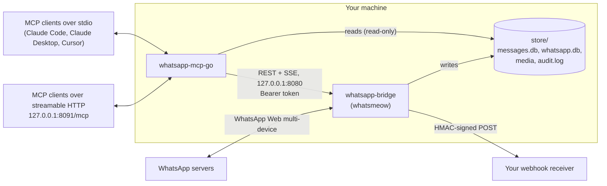

# WhatsApp MCP

Give an AI agent (Claude Code, Claude Desktop, Cursor, any MCP client) access to your personal WhatsApp account: read and search chats, view media, transcribe voice messages, send messages, manage groups. Two Go programs, a bridge and an MCP server, running locally.

[](https://github.com/Roman-Andr/whatsapp-mcp/actions/workflows/ci.yml)
[](https://github.com/Roman-Andr/whatsapp-mcp/actions/workflows/codeql.yml)
[](LICENSE)
[](whatsapp-mcp-go/go.mod)

The **bridge** (`whatsapp-bridge/`) links to your account as a WhatsApp Web device through [whatsmeow](https://github.com/tulir/whatsmeow), keeps every message in a local SQLite store and serves a token-protected REST API on localhost. The **MCP server** (`whatsapp-mcp-go/`) reads that store and calls the bridge for anything that changes state, exposing 59 tools, resources and live events over stdio or streamable HTTP.

Nothing leaves your machine except through WhatsApp itself and the tool results your MCP client passes to its model. The bridge enforces the limits that matter (send and read allowlists, read-only mode, a human-pace send rate, the directories files may be sent from), so they hold even when an agent is prompt-injected.

> [!CAUTION]
> Like any agent with access to private messages and the ability to send them, this is exposed to [the lethal trifecta](https://simonwillison.net/2025/Jun/16/the-lethal-trifecta/): a prompt injection in an incoming message can try to make an agent leak data or send messages. Use the allowlists, keep confirmation on for sending tools, and read [Safety](#safety).

## Contents

- [Features](#features)
- [Quick start](#quick-start)
- [Architecture](#architecture)
- [Configuration](#configuration)
- [MCP tools](#mcp-tools)
- [Resources and events](#resources-and-events)
- [REST API](#rest-api)
- [Safety](#safety)
- [Development](#development)
- [Troubleshooting](#troubleshooting)
- [Limitations](#limitations)
- [Credits](#credits)

## Features

**Reading**
- Messages with sender names (LID-addressed group members resolved to names and numbers), replies with the quoted text, reactions, edits (`edited`) and deletions (`deleted by sender`, original text kept), times with their UTC offset.
- Full-text search (SQLite FTS5, word and prefix matching, case-insensitive in every script) with substring fallback.
- Captions, locations, contact cards, polls with their votes, WhatsApp events with responses, business template and interactive messages, group changes (`[group] …`) and calls (`[call] …`) stored as readable lines.
- Unread counts kept in step with the phone; archived, pinned, muted and labelled chats; starred messages.
- Older history on demand (`request_chat_history` asks the phone).

**Sending**
- Text with replies and @mentions, files (real MIME type and file name), voice messages (converted with ffmpeg), stickers (any image converted to WebP), polls, locations, contact cards, forwards, statuses.
- Reactions, editing and deleting your own messages (admins can delete anyone's in their groups), voting in polls, read receipts, typing indicator.

**Media and voice**
- New media downloaded on arrival by a background queue; expired media re-requested from the phone.
- `view_media` returns the image itself to the model (scaled to fit), or a video's first frame.
- `transcribe_voice_message` transcribes locally with [whisper.cpp](https://github.com/ggml-org/whisper.cpp); transcripts are cached and shown in message listings.

**Groups and communities**
- Group info with every member's name, number, LID and role; create, join, leave, add/remove/promote/demote, settings, join requests, invite link reset, disappearing messages.
- Communities: create, link and unlink groups, list a community's groups.
- Optional welcome message for people who join (`WHATSAPP_WELCOME_FILE`).

**Contacts, channels, statuses**
- Whether a number is on WhatsApp, "about" text, business name, profile pictures, block/unblock, presence (opt-in).
- Channels you follow and their posts, follow/unfollow; contacts' statuses.

**Chat list**
- Archive, pin, mute, delete chats on every device; WhatsApp Business labels; stars.

**Events and export**
- Server-sent event stream and an HMAC-signed webhook for new messages, edits, deletions, reactions, poll votes, group changes, calls and session problems; `wait_for_events` for agents; MCP resource update notifications.
- `export_chat` writes a chat as text, JSON or an HTML page, optionally with its media in a ZIP.

**Operation**
- Several accounts: one bridge per account, one MCP server for all of them.
- systemd user units for the bridge and for one MCP server shared by every client.
- Headless pairing: QR code as a PNG file or over the API, or a pairing code entered on the phone.
- Lost sessions (logged out, QR needed, another client took over, temporary ban, outdated client) are reported with what to do.

**Security**
- Send allowlist and read allowlist, enforced by the bridge; read-only mode; send rate limit; media roots; audit log of every state-changing call; private file modes on the store; API token on every request; webhook signing. See [Safety](#safety).

## Quick start

Prerequisites: **Go 1.26+** and a C compiler (SQLite is built with cgo). Optional: **ffmpeg** (non-Ogg voice messages, a video's first frame) and whisper.cpp's **whisper-cli** (transcription, see [Transcription](#transcription)). Everything else works without them.

### 1. Build the bridge and link your account

```bash
git clone https://github.com/Roman-Andr/whatsapp-mcp.git
cd whatsapp-mcp/whatsapp-bridge
make run        # go build -tags sqlite_fts5 -o whatsapp-bridge . && ./whatsapp-bridge
```

Scan the QR code in WhatsApp on your phone (Settings → Linked devices → Link a device). Without a terminal at hand, open `store/qr.png` or `GET /api/qr?format=png`, or start with `WHATSAPP_PAIR_PHONE=<number with country code>` and enter the printed code under Linked devices → Link with phone number. To receive more than about a year of history, set `WHATSAPP_HISTORY_DAYS` (e.g. `3650`) before linking; the first sync can take several minutes.

The bridge creates `store/api_token` on first start; the MCP server reads it from there. Keep the bridge running: it is what receives messages and sends them.

Without the `sqlite_fts5` build tag (`make` sets it) the bridge still works, but search falls back to substring matching.

### 2. Build the MCP server

```bash
cd ../whatsapp-mcp-go
make build      # → ./whatsapp-mcp-go
```

It finds the store at `../whatsapp-bridge/store` relative to the binary; set `WHATSAPP_STORE_DIR` if it lives elsewhere.

### 3. Register it with your client

**stdio** (any OS; the client starts one server process per session, ~25 ms and ~20 MB each):

```bash
claude mcp add -s user whatsapp -- /path/to/whatsapp-mcp/whatsapp-mcp-go/whatsapp-mcp-go
```

Claude Desktop (`claude_desktop_config.json`) or Cursor (`~/.cursor/mcp.json`):

```json
{
  "mcpServers": {
    "whatsapp": { "command": "/path/to/whatsapp-mcp/whatsapp-mcp-go/whatsapp-mcp-go" }
  }
}
```

**Shared HTTP service** (Linux, recommended with several sessions): one server for every client, see [Running as services](#running-as-services).

```bash
claude mcp add -s user --transport http whatsapp http://127.0.0.1:8091/mcp \
  --header "Authorization: Bearer $(sed -n 's/^WHATSAPP_MCP_TOKEN=//p' ~/.config/whatsapp-mcp/env)"
```

Restart the client after changing its configuration, and restart MCP server processes after updating the bridge.

### 4. Try it

- "What did I miss in the family group today? Summarise it."
- "Transcribe the last voice message from Anna."
- "Show me the screenshot Mark sent yesterday."
- "Find the message where someone mentioned the invoice number."
- "Reply to David's last message: on my way."

### Running as services

On Linux both programs come with systemd user units (restart on failure, logs in journald):

```bash
cd whatsapp-bridge
make install-service                          # after linking with `make run` once; stop that bridge first
systemctl --user enable --now whatsapp-bridge

cd ../whatsapp-mcp-go
make build && make install-service            # also creates ~/.config/whatsapp-mcp/env (0600) with a random WHATSAPP_MCP_TOKEN
systemctl --user enable --now whatsapp-mcp    # http://127.0.0.1:8091/mcp

loginctl enable-linger "$USER"                # optional: keep running while logged out
```

Settings go into `~/.config/whatsapp-bridge/env` and `~/.config/whatsapp-mcp/env`, one `VAR=value` per line; restart the unit after changing them. Only one bridge may use a session at a time.

The MCP unit starts after the bridge but does not depend on it: while the bridge restarts, tools report it unreachable and the event stream reconnects every 10 s. Reinstalling keeps the token. Sessions idle for 30 minutes are closed (clients reconnect on the next call); on SIGTERM the server stops within about a second, cancelling running calls. `make uninstall-service` removes either unit. The bridge exits with status 1 when it cannot start; systemd gives up after five failures in ten minutes (check `journalctl --user -u whatsapp-bridge`, usually a QR code to scan or another bridge on the port).

The HTTP transport can also be run by hand; it listens on localhost unless `--host` says otherwise, so put it behind TLS before exposing it:

```bash
WHATSAPP_MCP_TOKEN=$(openssl rand -hex 24) ./whatsapp-mcp-go --transport http   # --host, --port
```

### Several accounts

Run one bridge per account, each in its own directory and on its own port, then tell the MCP server about them:

```bash
cd whatsapp-bridge && make install-account-service     # template unit whatsapp-bridge@<name>
mkdir -p ~/.config/whatsapp-bridge && echo WHATSAPP_BRIDGE_ADDR=127.0.0.1:8081 > ~/.config/whatsapp-bridge/work.env
WHATSAPP_BRIDGE_DIR=~/.local/share/whatsapp-bridge/work WHATSAPP_BRIDGE_ADDR=127.0.0.1:8081 ./whatsapp-bridge   # link, Ctrl+C
systemctl --user enable --now whatsapp-bridge@work

export WHATSAPP_ACCOUNTS='{"work": {"store_dir": "~/.local/share/whatsapp-bridge/work/store", "api_url": "http://localhost:8081/api"}}'
```

The first bridge stays the account `default`. Every tool then takes an `account` argument; `list_accounts` shows them. Every bridge setting (allowlists, rate limit, …) is per account.

### Windows

cgo is off by default on Windows. Install a C compiler (e.g. [MSYS2](https://www.msys2.org/), with `ucrt64\bin` in `PATH`), then:

```bash
go env -w CGO_ENABLED=1
cd whatsapp-bridge && go build -tags sqlite_fts5 -o whatsapp-bridge.exe .
cd ../whatsapp-mcp-go && go build -tags sqlite_fts5 -o whatsapp-mcp-go.exe .
```

### Upgrading

Stop the bridge, pull, `make build` both programs, start again, and restart the MCP server. The message database is migrated in place on start; existing rows are kept.

## Architecture



- **Bridge** (`whatsapp-bridge/`): one process per account. Keeps the WhatsApp session in `store/whatsapp.db` (whatsmeow's keys, contacts, LID map) and messages, chats, reactions, polls and labels in `store/messages.db`. Downloads land in `store/<chat JID>/`, profile pictures in `store/avatars/`, transcripts in `store/transcripts/`, exports in `store/exports/`. Every change goes through the REST API, which applies the allowlists, read-only mode, rate limit and media roots, and writes `store/audit.log`.
- **MCP server** (`whatsapp-mcp-go/`): reads both databases read-only and calls the bridge API for everything else. It does its media work in-process (image scaling, WebP stickers, Ogg/Opus decoding, all pure Go) and runs `whisper-cli` and `ffmpeg` as child processes. Built on the official [MCP Go SDK](https://github.com/modelcontextprotocol/go-sdk). `whatsapp-mcp-go export <chat JID> --format html --media` exports a chat from the command line.

The store contains your messages and your login. Never share it; the bridge keeps it `0700` and its files `0600`.

## Configuration

Environment variables. The bridge reads them at start; with systemd, put them in the unit's env file.

<details>
<summary><b>Bridge</b>: API, pairing, media, behaviour</summary>

| Variable | Default | Meaning |
|---|---|---|
| `WHATSAPP_BRIDGE_ADDR` | `127.0.0.1:8080` | Listen address of the REST API |
| `WHATSAPP_BRIDGE_TOKEN` | contents of `store/api_token` | API token; set the same value for the MCP server to override the generated one |
| `WHATSAPP_BRIDGE_DIR` | current directory | Directory holding this bridge's `store/` (one per account) |
| `WHATSAPP_PAIR_PHONE` | unset | Link with a code entered on the phone (number with country code) instead of the QR code |
| `WHATSAPP_DEVICE_NAME` | `whatsmeow` | Name shown under Linked devices (max 50 characters); only applies when linking |
| `WHATSAPP_HISTORY_DAYS` | phone default (~1 year) | Days of history to request when linking; ignored once linked |
| `WHATSAPP_AUTO_DOWNLOAD` | on | `0`/`false`/`off` stops downloading new media on arrival |
| `WHATSAPP_AUTO_DOWNLOAD_MAX_VIDEO_MB` | `25` | Largest video downloaded automatically |
| `WHATSAPP_AUTO_DOWNLOAD_MAX_MB` | `100` | Largest image, voice message or document downloaded automatically |
| `WHATSAPP_PRESENCE` | off | `1` enables `get_presence`; the bridge then shows as online, which stops notifications on your phone |
| `WHATSAPP_REJECT_CALLS` | off | `1` declines incoming 1:1 calls |
| `WHATSAPP_REJECT_CALLS_MESSAGE` | unset | Text sent to a caller whose call was declined |
| `WHATSAPP_WELCOME_FILE` | unset | JSON object of group JID → text sent to people who join; `{name}` and `{mention}` are replaced |

</details>

<details>
<summary><b>Bridge</b>: security limits and webhook</summary>

| Variable | Default | Meaning |
|---|---|---|
| `WHATSAPP_SEND_ALLOWLIST` | unset (unrestricted) | Chats the bridge may send to or change anything in: JIDs or phone numbers, separated by commas or spaces |
| `WHATSAPP_SEND_ALLOWLIST_FILE` | unset | More entries, one per line, `#` comments |
| `WHATSAPP_READ_ALLOWLIST` | unset (all chats) | Chats whose messages, media, history, group info and events may be read; same format |
| `WHATSAPP_READ_ALLOWLIST_FILE` | unset | More read allowlist entries |
| `WHATSAPP_READ_ONLY` | off | `1` refuses every change |
| `WHATSAPP_SEND_RATE` | `10` | Messages, reactions and group changes per minute; `0` turns the limit off |
| `WHATSAPP_SEND_BURST` | `3` | How many may go out at once before the rate applies |
| `WHATSAPP_MEDIA_ROOTS` | `store/`, `~/.local/share/whatsapp-mcp/outbox`, temp dir | Directories files may be sent from, `:`-separated; replaces the defaults |
| `WHATSAPP_WEBHOOK_URL` | unset | POST every event as JSON to this URL |
| `WHATSAPP_WEBHOOK_SECRET` | contents of `store/webhook_secret` | HMAC key for webhook signatures; generated when a webhook URL is set |
| `WHATSAPP_WEBHOOK_DISABLED` | off | `1` pauses the webhook while keeping its URL |

</details>

<details>
<summary><b>MCP server</b></summary>

| Variable | Default | Meaning |
|---|---|---|
| `WHATSAPP_STORE_DIR` | `../whatsapp-bridge/store` next to the binary | Where `messages.db`, `whatsapp.db` and `api_token` are |
| `WHATSAPP_API_BASE_URL` | `http://localhost:8080/api` | Where the bridge API is |
| `WHATSAPP_BRIDGE_TOKEN` | contents of `store/api_token` | Bridge API token |
| `WHATSAPP_MCP_TRANSPORT` | `stdio` | `http` serves streamable HTTP (same as `--transport http`) |
| `WHATSAPP_MCP_HOST`, `WHATSAPP_MCP_PORT` | `127.0.0.1`, `8091` | HTTP listen address (`--host`, `--port`) |
| `WHATSAPP_MCP_TOKEN` | unset | Required for HTTP (16+ characters); clients send `Authorization: Bearer <token>` |
| `WHATSAPP_ACCOUNTS` / `WHATSAPP_ACCOUNTS_FILE` | unset | JSON object of account name → `{"store_dir", "api_url", "token"?}` |
| `WHATSAPP_DEFAULT_ACCOUNT` | `default` | Account used when a tool gets no `account` |
| `WHATSAPP_READ_ALLOWLIST`, `WHATSAPP_READ_ALLOWLIST_FILE` | unset | Narrows the bridge's read allowlist further: a chat must be on both |
| `WHATSAPP_READ_ONLY` | off | `1` hides every tool that sends or changes something |
| `WHATSAPP_WHISPER_MODEL` | `small` | whisper.cpp model name (`tiny`, `base`, `small`, `medium`, `large-v3`, `turbo`, `*.en`, `small-q8_0`, …) or a path to a ggml `.bin` |
| `WHATSAPP_WHISPER_CLI` | `whisper-cli` in `PATH` | The whisper-cli binary |
| `WHATSAPP_WHISPER_CACHE` | `~/.cache/whatsapp-mcp/whisper` | Where models are downloaded on first use (from Hugging Face, SHA-256 checked) |
| `WHATSAPP_WHISPER_THREADS` | CPU count, at most 8 | whisper-cli threads |

</details>

### Transcription

`transcribe_voice_message` needs whisper.cpp's `whisper-cli`. Build it once (git, a C/C++ compiler, cmake; without cmake the script fetches it with `uvx`):

```bash
JOBS=4 whatsapp-mcp-go/media/transcribe/build-whisper.sh   # → ~/.local/share/whatsapp-mcp/whisper.cpp/bin/whisper-cli
```

Link it into `~/.local/bin` (the MCP unit has that in `PATH`) or set `WHATSAPP_WHISPER_CLI`. The first transcription downloads the model (`small`: 466 MiB). Voice notes are decoded in Go, so whisper-cli needs no ffmpeg; MP3, WAV and FLAC go to whisper-cli directly (M4A/AAC is not supported). An 11-second note takes about 5–6 s with `small` on 8 threads; passing `language` skips detection and is faster. Without whisper-cli the tool says how to build it, and cached transcripts are still shown.

### Webhook

With `WHATSAPP_WEBHOOK_URL` set, the bridge POSTs every event (the JSON objects `/api/events` streams) one at a time with a 15-second timeout. Redirects are not followed; failed deliveries are logged and not retried. Each request carries `X-Bridge-Timestamp` (unix seconds) and `X-Bridge-Signature: sha256=<hex>`, the HMAC-SHA256 of `<timestamp>.<body>`. The API token is never sent. Verify in constant time and reject old timestamps:

```python
import hashlib, hmac, time

def verify(secret: bytes, headers, body: bytes) -> bool:
    ts = headers["X-Bridge-Timestamp"]
    expected = "sha256=" + hmac.new(secret, ts.encode() + b"." + body, hashlib.sha256).hexdigest()
    return hmac.compare_digest(expected, headers["X-Bridge-Signature"]) and abs(time.time() - int(ts)) < 300
```

## MCP tools

59 tools. Read tools are annotated `readOnlyHint`; sending and group tools `destructiveHint` + `openWorldHint`, so clients can auto-approve reads and ask before sends. With `WHATSAPP_READ_ONLY` only the read tools are listed. With several accounts every tool takes `account`.

| Area | Tools |
|---|---|
| Messages | `list_messages` (filter by chat, sender, dates, text, starred; with context), `get_message_context`, `request_chat_history` |
| Chats | `list_chats`, `list_unread_chats`, `get_chat`, `get_direct_chat_by_contact`, `get_contact_chats`, `get_last_interaction` |
| Sending | `send_message` (reply, mentions), `send_file`, `send_audio_message`, `send_sticker`, `send_poll`, `send_location`, `send_contact`, `forward_message`, `send_reaction`, `vote_poll` |
| Own messages | `edit_message` (text, within 20 minutes), `delete_message` (for everyone), `mark_read`, `send_typing` |
| Media | `download_media`, `view_media`, `transcribe_voice_message` |
| Groups | `get_group_info`, `create_group` (also communities), `join_group`, `leave_group`, `update_group_participants`, `update_group_settings`, `get_group_join_requests`, `update_group_join_requests`, `reset_group_invite_link`, `set_disappearing_messages` |
| Communities | `link_community_group`, `list_community_groups` |
| Contacts | `search_contacts`, `get_contact_info`, `view_profile_picture`, `get_presence`, `block_contact`, `list_blocked_contacts` |
| Channels, statuses | `list_channels`, `get_channel_messages`, `follow_channel`, `list_statuses`, `post_status` |
| Chat list | `manage_chat` (archive, pin, mute, delete), `list_labels`, `label_chat`, `edit_label`, `star_message` |
| Events, export | `wait_for_events`, `export_chat` |
| Bridge, accounts | `get_bridge_status` (connection, session warnings, limits, pairing QR), `reconnect_bridge`, `list_accounts` |

Each message line shows the message id and chat JID that the other tools take, plus the sender's name, media details, the quoted message, reactions, poll votes, edits, deletions and the voice transcript. The full parameter documentation is in [`whatsapp-mcp-go/internal/tools/table.go`](whatsapp-mcp-go/internal/tools/table.go) and is what clients see.

## Resources and events

**Resources:** `whatsapp://chats`, `whatsapp://chats/unread`, `whatsapp://chat/{chat_jid}` and `whatsapp://status`. With several accounts each also has `whatsapp://{account}/chats` (and so on), under that account's read allowlist. The server follows every bridge's event stream and notifies clients subscribed through `subscriptions/listen` or `resources/subscribe`.

**Events** (`GET /api/events` as server-sent events, the webhook, and `wait_for_events`): `message`, `edit`, `delete`, `reaction`, `poll_vote`, `event_response`, `history`, `group`, `call`, `presence`, `unavailable` (a message that could not be decrypted yet) and `session` (logged out, QR needed, stream replaced, temporary ban, outdated client).

## REST API

The bridge API listens on `127.0.0.1:8080` and requires `Authorization: Bearer <token>` (or `X-API-Token`) on every request. The MCP server is its main client, but scripts can use it directly.

<details>
<summary>Routes</summary>

| Route | Body | Does |
|---|---|---|
| `POST /api/send` | `recipient`, `message`, `media_path?`, `reply_to_message_id?`, `mentions?`, `sticker?` | Send text or a file; returns `message_id` |
| `POST /api/react` | `chat_jid`, `message_id`, `emoji` | React; empty `emoji` removes the reaction |
| `POST /api/edit` | `chat_jid`, `message_id`, `message` | Edit an own text message (20-minute window) |
| `POST /api/delete` | `chat_jid`, `message_id` | Delete for everyone (own messages, or any as group admin) |
| `POST /api/poll` | `recipient`, `question`, `options`, `selectable_count?` | Send a poll (default 1 choice, 0 = any) |
| `POST /api/poll/vote` | `chat_jid`, `message_id`, `options` | Vote; `[]` withdraws |
| `POST /api/location` | `recipient`, `latitude`, `longitude`, `name?`, `address?` | Send a location |
| `POST /api/contact` | `recipient`, `name`, `phone` or `vcard` | Send a contact card |
| `POST /api/sticker` | `recipient`, `media_path` (.webp), `reply_to_message_id?` | Send a sticker |
| `POST /api/forward` | `chat_jid`, `message_id`, `recipient` | Forward a message |
| `POST /api/star` | `chat_jid`, `message_id`, `starred` | Star or unstar |
| `POST /api/read` | `chat_jid`, `message_ids?` | Read receipts; without ids the newest 20 incoming messages |
| `POST /api/typing` | `chat_jid`, `state` (`composing`, `recording`, `paused`) | Typing indicator |
| `POST /api/download` | `chat_jid`, `message_id` | Download media; returns `path`, `media_type`, `mimetype` |
| `POST /api/history` | `chat_jid`, `count?`, `before_message_id?` | Request older messages from the phone |
| `POST /api/group` | `chat_jid`, `invite_link?` | Group info and members |
| `POST /api/group/create` | `name`, `participants` | Create a group |
| `POST /api/group/join` | `invite` (link or code) | Join through an invite link |
| `POST /api/group/leave` | `chat_jid` | Leave a group |
| `POST /api/group/participants` | `chat_jid`, `action` (`add`, `remove`, `promote`, `demote`), `participants` | Change members |
| `POST /api/group/settings` | `chat_jid`, `name?`, `description?`, `announce_only?`, `locked?` | Change settings |
| `POST /api/group/requests` | `chat_jid` | Pending join requests |
| `POST /api/group/requests/update` | `chat_jid`, `action` (`approve`, `reject`), `participants` | Answer join requests |
| `POST /api/group/invite/reset` | `chat_jid` | New invite link |
| `POST /api/community/link` | `community_jid`, `group_jid`, `unlink?` | Add or remove a community's group |
| `POST /api/community/groups` | `community_jid` | Groups of a community |
| `POST /api/chat` | `chat_jid`, `action` (`archive`, `unarchive`, `pin`, `unpin`, `mute`, `unmute`, `delete`), `mute_hours?` | Change the chat on every device |
| `POST /api/chat/disappearing` | `chat_jid`, `timer` (`off`, `24h`, `7d`, `90d`) | Disappearing messages |
| `POST /api/label/chat` | `chat_jid`, `label` (id or name), `labeled` | Add or remove a label |
| `POST /api/label/edit` | `label_id?`, `name`, `color?` (0–19), `deleted?` | Create, change or delete a label |
| `POST /api/contact/info` | `jid`, `picture?` | About a person; with `picture` the profile picture is saved |
| `POST /api/block` | `jid`, `blocked` | Block or unblock |
| `GET /api/blocklist` | – | Blocked contacts |
| `POST /api/presence` | `jid` | Online / last seen (needs `WHATSAPP_PRESENCE`) |
| `GET /api/channels` | – | Channels you follow |
| `POST /api/channel/messages` | `channel_jid`, `count?`, `before_server_id?` | Posts of a channel |
| `POST /api/channel/follow` | `channel` (JID, link or code), `follow` | Follow or unfollow |
| `GET /api/status` | – | Connection, session state, own JID, full-text search, allowlists, read-only, pairing |
| `GET /api/qr` | `?format=png` | While not linked: QR code text, pairing code, or the QR image |
| `POST /api/connection/reconnect` | – | Reopen the WhatsApp connection (at most every 30 s) |
| `POST /api/logout` | `confirm: true` | Unlink this device; the bridge exits so the service restarts it for pairing |
| `GET /api/events` | – | Server-sent events (see [Resources and events](#resources-and-events)) |

State-changing routes answer `403` outside the send allowlist or in read-only mode and `429` (with `Retry-After`) over the rate limit, and are recorded in `store/audit.log`. Read routes answer `403` for, or leave out, chats outside the read allowlist.

</details>

## Safety

WhatsApp does not allow unofficial clients. This project uses the same multi-device protocol as WhatsApp Web, but **your account can be restricted or banned**, especially for automated or bulk sending. Use it for your own account at human pace; don't use it for spam or mass messaging.

- **Rate limit:** by default at most 10 sends per minute after a burst of 3 (`WHATSAPP_SEND_RATE`, `WHATSAPP_SEND_BURST`). A burst of 8 operations in 4 seconds once got a linked device removed; raise the limits with care.
- **Send allowlist:** `WHATSAPP_SEND_ALLOWLIST` restricts every sending or changing action to listed chats. It is enforced in the bridge, so a prompt-injected agent cannot get around it. Empty means unrestricted, so set it.
- **Read allowlist:** `WHATSAPP_READ_ALLOWLIST` restricts what the bridge API and the MCP server hand out. Anything with direct access to `store/` still sees everything; run the agent as another user if that matters.
- **Read-only mode:** `WHATSAPP_READ_ONLY=1` on the bridge refuses every change; on the MCP server it hides every sending tool.
- **Media roots:** files are only sent from `WHATSAPP_MEDIA_ROOTS` (resolved through symlinks; hidden files and the store's own databases and token are refused), so an agent cannot be talked into sending `~/.ssh` or the session database. The bridge publishes its roots in `messages.db`, and the MCP server checks them before converting a file into a sticker or voice message.
- **Other people's edits and deletions** are checked against the author, so a group member cannot rewrite your stored history.
- **Audit log:** every state-changing call, allowed or refused, is a JSON line in `store/audit.log`.
- **Presence** (`WHATSAPP_PRESENCE`) keeps the bridge online and silences your phone's notifications; it is off by default.

Report vulnerabilities as described in [SECURITY.md](SECURITY.md).

## Development

```bash
cd whatsapp-bridge && make test      # go vet + go test, with FTS5
cd whatsapp-mcp-go && make test      # the server and its media packages
cd whatsapp-mcp-go && make lint      # gofmt + golangci-lint (the version CI pins)
```

For the bridge, lint as CI does with `gofmt -l .` and `go run github.com/golangci/golangci-lint/v2/cmd/golangci-lint@v2.14.0 run --build-tags sqlite_fts5`.

[CI](.github/workflows/ci.yml) runs gofmt, golangci-lint and `make test` for both modules on every push to `main` and every pull request; [CodeQL](.github/workflows/codeql.yml) scans the Go code on the same triggers and weekly; Dependabot proposes grouped weekly updates for both Go modules and the Actions.

Layout:

- `whatsapp-bridge/`: `main.go` reads the environment and signals and runs `internal/app`; the rest lives in `internal/`:
  - `app/`: start-up, pairing, connecting, ordered shutdown; `console.go` is the terminal output (QR code, banners).
  - `api/`: the REST API, token check, guard (read-only, rate limit), audit and SSE.
  - `bridge/`: the service: ingesting events (`ingest_*.go`) and the actions the API calls (send, modify, groups, chats, contacts, channels).
  - `wa/`: the WhatsApp client interface and its whatsmeow adapter, session state, pairing, reconnects; `wa/watest/` is the fake client for tests.
  - `media/`: downloads and re-uploads of attachments, the auto-download queue, avatars, Ogg analysis.
  - `store/`: `messages.db` (schema, migrations, full-text search).
  - `content/`: message → text and media details.
  - `events/`: SSE fan-out and the webhook.
  - `policy/`: allowlists, rate limit, media roots.
  - `config/`: the environment settings.
  - `audit/`, `jid/`, `logging/`: the audit log, JID parsing, the slog setup.
- `whatsapp-mcp-go/`: `main.go` (flags, signals, the `export` subcommand) and `internal/`: `tools` (`table.go` holds every tool's parameters, description and handler; the handlers live in one file per area, `args.go` coerces arguments, `result.go` shapes results and errors), `resources` (resources and the event pump), `server` (stdio and HTTP serving), `store` (the read-only SQLite store and the read allowlist), `bridgeapi` (bridge API client), `render` (message lines), `export`, `mediaconv` (conversions, media roots), `account`, `config`, `logging`, `pyfmt` (Python-compatible output). `media/` holds `audio`, `transcribe`, `sticker` and `modelimage`, pure Go; transcription runs `whisper-cli` as a child process.

Contributions are welcome; see [CONTRIBUTING.md](CONTRIBUTING.md).

## Troubleshooting

| Symptom | Fix |
|---|---|
| `401 Unauthorized`, "Bridge rejected the API token" | The MCP server process is older than the bridge, or `WHATSAPP_BRIDGE_TOKEN` differs. Restart the MCP server. |
| "Request error (is the bridge running?)" | Start the bridge; check `get_bridge_status`. |
| `get_bridge_status` shows a `warning` | `logged_out` / `qr_required`: run the bridge in a terminal and link again. `stream_replaced`: another bridge uses the session; stop it. `client_outdated`: update whatsmeow and rebuild. |
| Session stays `disconnected` | `reconnect_bridge` (or `POST /api/connection/reconnect`). |
| QR code not displayed | Open `store/qr.png` or `GET /api/qr?format=png`, or use `WHATSAPP_PAIR_PHONE`. |
| "… is not in the send allowlist" (403) | Add the chat; for direct chats list both the phone number and the LID if needed. Restart the bridge. |
| "… is outside the media roots" (403) | Copy the file into `~/.local/share/whatsapp-mcp/outbox`, or add its directory to `WHATSAPP_MEDIA_ROOTS`. |
| "send rate limit reached" (429) | Wait as the message says, or raise `WHATSAPP_SEND_RATE` / `WHATSAPP_SEND_BURST`. |
| "read-only mode" (403) | The bridge runs with `WHATSAPP_READ_ONLY`. |
| A chat is missing from `list_chats` | It is outside the read allowlist, or was deleted on a device (`get_chat` still finds it). |
| `[message unavailable: …]` | Not decrypted yet; replaced when the sender's device or your phone resends it (the phone must be online). |
| No messages after linking | The first history sync can take several minutes. |
| Search only matches substrings | The bridge was built without `-tags sqlite_fts5`; rebuild with `make build`. |
| Group messages from an old install lack senders | `request_chat_history(chat_jid=…, count=500, before_message_id=<newest id>)` re-fetches and repairs them. |
| Hopelessly out of sync | Stop the bridge, delete `store/messages.db` and `store/whatsapp.db`, start and link again. |

## Limitations

- **Old media may be gone.** WhatsApp's CDN forgets media after a few weeks. The bridge asks the phone to re-upload it, but the phone often re-uploads it with a key it does not send back, and the file cannot be decrypted. Media received while the bridge runs is downloaded at once (videos up to 25 MB by default).
- History requests and media re-uploads only work while the phone is online.
- Only your own **text** messages can be edited, within 20 minutes. Other people's messages can be deleted only as a group admin.
- **Poll votes and event responses** are decrypted only for polls and events the bridge has seen.
- **Typing indicators** may not show while the bridge is not "online", which it avoids so your phone keeps notifying you.
- **Unread counts** start from the phone's snapshot at linking; messages received while the bridge was stopped are not counted. **Calls** are recorded only while it runs; it never answers them and only declines 1:1 calls.
- **Channels** are read on demand, not stored. **Labels** exist on WhatsApp Business accounts only.
- A direct chat addressed by a LID whose phone number the bridge has not learned yet stays a separate chat until it learns the mapping; the send allowlist matches such chats only by the form it knows.
- `WHATSAPP_DEVICE_NAME` and `WHATSAPP_HISTORY_DAYS` only apply when linking; log out (`POST /api/logout`) and link again to change them.
- A linked device may have to be re-linked after about 20 days without use.

## Credits

- Originally based on [lharries/whatsapp-mcp](https://github.com/lharries/whatsapp-mcp) by Luke Harries (MIT). This project has since been rewritten: both programs are Go, and most features above are new.
- [whatsmeow](https://github.com/tulir/whatsmeow) by Tulir Asokan, the WhatsApp Web multi-device library.
- The [MCP Go SDK](https://github.com/modelcontextprotocol/go-sdk).
- [whisper.cpp](https://github.com/ggml-org/whisper.cpp) for local transcription; [darui3018823/opus](https://github.com/darui3018823/opus) and [gen2brain/webp](https://github.com/gen2brain/webp) for pure-Go audio and WebP.

This project is not affiliated with or endorsed by WhatsApp or Meta.

## License

[MIT](LICENSE).
